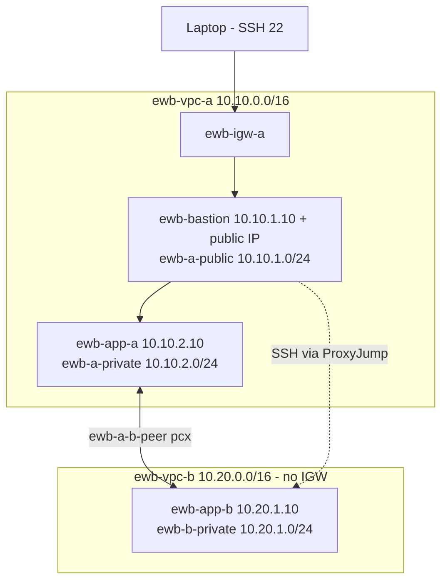

# AWS VPC Peering - EWB Courses Project 01

**Name:** YOUR NAME  |  **Batch:** YOUR BATCH  |  **Region:** ap-south-1 (Mumbai)  |  **Date:** DD-MM-YYYY

Two private VPCs connected with VPC peering, with one public bastion in VPC A for SSH administration (ProxyJump). Neither application server has a public IP.

## Architecture



## Resource inventory (fill with your real IDs)

| Resource | Name | CIDR / IP | ID |
|---|---|---|---|
| VPC A | ewb-vpc-a | 10.10.0.0/16 | vpc-... |
| Public subnet | ewb-a-public | 10.10.1.0/24 | subnet-... |
| Private subnet A | ewb-a-private | 10.10.2.0/24 | subnet-... |
| VPC B | ewb-vpc-b | 10.20.0.0/16 | vpc-... |
| Private subnet B | ewb-b-private | 10.20.1.0/24 | subnet-... |
| Internet gateway | ewb-igw-a | - | igw-... |
| Peering | ewb-a-b-peer | - | pcx-... |
| Bastion | ewb-bastion | 10.10.1.10 + public IP | i-... |
| App-A | ewb-app-a | 10.10.2.10 | i-... |
| App-B | ewb-app-b | 10.20.1.10 | i-... |

(IDs are saved in `~/.ewb-state.env` after running the script.)

## Route tables

| Route table | Associated subnet | Routes |
|---|---|---|
| ewb-rt-a-public | ewb-a-public | 10.10.0.0/16 local; 0.0.0.0/0 igw; 10.20.0.0/16 pcx |
| ewb-rt-a-private | ewb-a-private | 10.10.0.0/16 local; 10.20.0.0/16 pcx |
| ewb-rt-b-private | ewb-b-private | 10.20.0.0/16 local; 10.10.0.0/16 pcx |

## Security group inbound rules

| SG | Rule | Source |
|---|---|---|
| ewb-sg-bastion | SSH 22 | my public IP /32 |
| ewb-sg-app-a | SSH 22 | 10.10.1.10/32 |
| ewb-sg-app-a | ICMP echo request | 10.20.1.10/32 |
| ewb-sg-app-b | SSH 22 | 10.10.1.10/32 |
| ewb-sg-app-b | ICMP echo request | 10.10.2.10/32 |

## Test evidence

| # | Test | Result | Screenshot / output |
|---|---|---|---|
| 01 | Baseline ping App-A -> App-B before peering | No replies | screenshots/05-baseline-ping-fail.png |
| 02 | Forward ping App-A -> App-B | 4/4 replies | screenshots/06-forward-ping.png |
| 03 | Reverse ping App-B -> App-A | 4/4 replies | screenshots/07-reverse-ping.png |
| 04 | SSH to App-B via bastion | Shell opened | screenshots/08-ssh-app-b.png |
| 05 | No public IPv4 on App-A/App-B | Confirmed | screenshots/09-no-public-ip.png |
| - | Controlled failure (ICMP rule removed) | Replies stopped | screenshots/10-icmp-failure.png |
| - | Recovery (rule restored) | Replies resumed | screenshots/11-icmp-recovery.png |
| - | Cleanup | All resources deleted | screenshots/12-cleanup.png |

> Update the Result column only with what you actually observed.

## Forward and return path, controlled failure, learnings
See [docs/explanations.md](docs/explanations.md).

## How to reproduce
```bash
export STUDENT="Your Name"
./ewb_vpc_peering.sh build
./ewb_vpc_peering.sh baseline
./ewb_vpc_peering.sh peer
./ewb_vpc_peering.sh verify
./ewb_vpc_peering.sh failure
./ewb_vpc_peering.sh cleanup   # after saving all screenshots
```
Requires AWS CLI v2 configured for ap-south-1, OpenSSH, and a lab account with VPC/EC2 permissions.

## Security note
No private keys, credentials or tokens are committed (`.gitignore` excludes `*.pem`).
